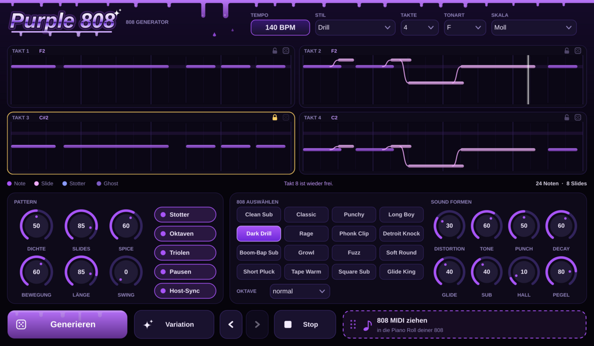

# Purple 808

Ein 808-Generator als VST3-Plugin für FL Studio (und jede andere DAW mit VST3). Er baut komplette
808-Patterns für heutigen Hip-Hop, mit Slides und weiterem Ear Candy, passend zum Tempo des Projekts,
und bringt 16 eigene 808-Sounds mit, die sich mit Reglern formen lassen.



## Was das Plugin kann

- **16 eingebaute 808s**: Clean Sub, Classic, Punchy, Long Boy, Dark Drill, Rage, Phonk Clip,
  Detroit Knock, Boom-Bap Sub, Growl, Fuzz, Soft Round, Short Pluck, Tape Warm, Square Sub, Glide King.
  Ein Klick wählt den Sound und spielt ihn an.
- **Sound formen** mit acht Reglern: Distortion, Tone, Punch, Decay, Glide, Sub, Hall, Pegel.
  Der Hall wirkt nur oberhalb von etwa 180 Hz, der Sub bleibt trocken und fest.
- **Komplette Patterns** über 1, 2, 4 oder 8 Takte in 8 Stilen: Trap, Drill, Rage / Plugg, Detroit,
  West Coast, Boom-Bap, Phonk, Jersey Club. Jeder Stil hat eigene Rhythmus-Vorlagen.
- **Tonart und Skala**: Die Grundtöne der Takte folgen typischen Stufenfolgen in der gewählten
  Tonart (Moll, Harmonisch Moll, Phrygisch, Dorisch, Dur). Der Regler „Bewegung“ bestimmt, ob die
  808 auf dem Grundton bleibt oder wandert.
- **Slides**: Gleiten von Note zu Note und die typischen Slides am Ende einer langen Note
  (Oktave hoch, Quinte, Oktave runter). Der eingebaute Synth spielt sie als echtes Gleiten.
- **Weiteres Ear Candy**: Stotter (schnelle Anschläge vor einem Schlag), Oktav-Sprünge,
  Triolen-Bounce am Taktende, Ghost Notes, Pausen, Durchgangsnoten zum nächsten Takt, Swing.
- **Passt sich der BPM an**: Das Plugin liest das Tempo vom Host. Stotter und Slide-Längen richten
  sich danach, damit bei jedem Tempo jede Note sauber anspricht.
- **Regler wirken live**: Mehr „Slides“ fügt Slides hinzu, der Rest des Patterns bleibt stehen.
- **Takte festhalten und einzeln neu würfeln**, dazu „Variation“ und ein Verlauf mit Zurück/Vor.
- **Übersichtliche Pattern-Ansicht** als Piano Roll: Balken für jede Note, Slides als Linie an die
  Note davor gebunden, Grundton je Takt in der Kopfzeile, Abspielposition.
- **MIDI in FL Studio**: Feld „808 MIDI ziehen“ in die Piano Roll deiner eigenen 808 ziehen.
- Host-Sync, MIDI-Ausgang, und alles wird im Projekt gespeichert.

## Bauen

Der Ordner `Purple808` ist der Quellcode. Auf GitHub baut der Workflow „Purple 808 bauen“ das Plugin
automatisch (Reiter **Actions**, fertigen Lauf öffnen, unten bei **Artifacts**
`Purple808-Windows-VST3` herunterladen).

Lokal unter Windows: Visual Studio 2022 (Workload „Desktopentwicklung mit C++“), CMake und Git
installieren, dann `build_windows.bat` doppelklicken.

## In FL Studio installieren

1. Den ganzen Ordner `Purple 808.vst3` nach `C:\Program Files\Common Files\VST3` kopieren.
2. FL Studio: **Options → Manage plugins → Find installed plugins**.
3. Purple 808 bei den Instrumenten in den Channel Rack laden.

## Bedienung

| Bereich | Funktion |
|---|---|
| Tempo | Zeigt die BPM des Projekts. Das Pattern richtet sich danach. |
| Stil, Takte, Tonart, Skala | Oben rechts. |
| Pattern-Ansicht | Schloss hält einen Takt fest, der Würfel würfelt nur diesen Takt neu. |
| Dichte | Wie viele Schläge der Rhythmus hat. |
| Slides | Wie viele Slides vorkommen. |
| Spice | Wie viel Ear Candy: Stotter, Oktav-Sprünge, Triolen, Ghost Notes, Pausen. |
| Bewegung | 0 bleibt auf dem Grundton, mehr lässt die 808 durch die Tonart wandern. |
| Länge | Wie lang die Noten klingen, bevor der nächste Schlag kommt. |
| Swing | Verschiebt die ungeraden Sechzehntel. |
| Stotter, Oktaven, Triolen, Pausen | Schalten einzelne Arten von Ear Candy an und aus. |
| 808 auswählen | 16 Sounds. Klick wählt aus und spielt an. |
| Oktave | Legt die 808 eine Oktave tiefer oder höher. |
| Distortion | Verzerrung zusätzlich zur Grundfärbung des Sounds. |
| Tone | Dumpfer oder heller. |
| Punch | Wie stark der Ton am Anfang von oben herunterfällt, plus Klick. |
| Decay | Wie lange die 808 ausklingt. |
| Glide | Wie schnell Slides gleiten. |
| Sub | Mischt einen sauberen Sinus darunter. |
| Hall | Raum auf dem oberen Anteil. |
| Pegel | Lautstärke. |
| Generieren | Neues Pattern. Festgehaltene Takte bleiben. |
| Variation | Gleiche Grundtöne, neue Slides und Fills in der zweiten Takthälfte. |
| Play | Spielt das Pattern als Loop im Tempo des Projekts. |
| Host-Sync | Wenn an, spielt das Plugin mit, sobald FL Studio läuft. |
| 808 MIDI ziehen | Feld festhalten und in die Piano Roll ziehen. Doppelklick zeigt die Datei im Explorer. |

### Das Pattern mit deiner eigenen 808 benutzen

1. Deine 808 liegt in FL Studio in einem Sampler-Kanal.
2. „808 MIDI ziehen“ in die Piano Roll dieses Kanals ziehen.
3. Damit die Slides gleiten: In den Kanal-Einstellungen unter Polyphony **Mono** und **Porta**
   einschalten und die Slide-Zeit einstellen. In der MIDI-Datei überlappen Slide-Noten die Note
   davor, daraus macht FL Studio dann das Gleiten.
4. Purple 808 stummschalten oder den Pegel herunterdrehen.

## Projektaufbau

```
Source/BassEngine.h        Stile, Rhythmus-Vorlagen, Tonart, Slides, Ear Candy, MIDI-Datei (ohne JUCE)
Source/BassSynth.h         der 808-Synth mit 16 Sounds (ohne JUCE)
Source/PluginProcessor.*   Sequenzer, Host-Sync, Slides, Hall, MIDI-Ausgang, Speichern/Laden
Source/PluginEditor.*      Overlay
Source/Widgets.h           Pattern-Ansicht, 808-Auswahl, Buttons, Schalter, Drag-Feld
Source/Theme.h             Farben, Drips, Chrom-Schriftzug, Icons
tests/                     Tests für Engine und Plugin, rendert das Overlay als PNG
```

## Stand der Tests

Der Code wurde unter Linux gegen JUCE 8.0.8 kompiliert. Engine und Prozessor wurden automatisch
getestet (alle Stile bei 70 bis 190 BPM, Abspielen eines ganzen Loops, MIDI-Datei, Speichern/Laden),
alle 16 Sounds wurden auf Stimmung, Pegel und Glide gemessen, und das Overlay wurde gerendert
(Bilder in `docs/`). **Nicht** getestet ist das Verhalten in FL Studio selbst, insbesondere
Drag & Drop in die Piano Roll, und die Sounds wurden nur gemessen, nicht angehört.

## Lizenz-Hinweis

Das Plugin nutzt [JUCE](https://juce.com) (AGPLv3 oder kommerzielle Lizenz). Für den eigenen
Gebrauch ist das unproblematisch. Wer das Plugin weitergibt oder verkauft, muss die
JUCE-Lizenzbedingungen beachten.
