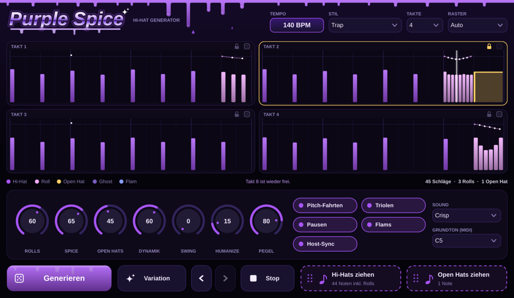

# Purple Spice

Ein Hi-Hat-Generator als VST3-Plugin für FL Studio (und jede andere DAW mit VST3). Er baut komplette
Hi-Hat-Patterns für heutigen Hip-Hop, mit Rolls, Pitch-Fahrten, Open Hats und weiterem Ear Candy,
passend zum Tempo des Projekts.



## Was das Plugin kann

- **Komplette Patterns** über 1, 2, 4 oder 8 Takte in 8 Stilen: Trap, Drill, Rage / Plugg, Detroit,
  West Coast, Boom-Bap, Lo-Fi, Phonk. Jeder Stil hat eigenes Raster, eigene Betonungen und eigenen Swing.
- **Passt sich der BPM an**: Das Plugin liest das Tempo vom Host. Davon hängt ab, ob das Grundraster
  1/8 oder 1/16 ist und welche Roll-Geschwindigkeiten vorkommen (1/16, 1/32, 1/64, Triolen). Rolls,
  die bei dem Tempo nur noch nach Rauschen klingen würden, werden nicht benutzt. Ändert sich das
  Tempo des Projekts, passt sich das Pattern an.
- **Rolls**: an musikalisch sinnvollen Stellen (Taktende, Ende der Phrase), mit Lautstärke-Verläufen
  (lauter, leiser, Delle) und Beschleunigung.
- **Ear Candy**
  - Pitch-Fahrten in Rolls (hoch, runter, runter-hoch, Treppe, Oktave, Wechsel) und einzelne gepitchte Schläge
  - Triolen-Wechsel
  - Open Hats auf den Offbeats, die vom nächsten Schlag abgewürgt werden
  - Pausen, damit der Groove atmet
  - Flams und Ghost Notes
  - Swing und Humanize
- **Regler wirken live**: Mehr „Rolls“ fügt Rolls hinzu, der Rest des Patterns bleibt stehen.
- **Phrasen statt Zufall**: Takte wiederholen ein Motiv und variieren die zweite Hälfte, der letzte
  Takt bekommt den Abschluss-Roll.
- **Takte festhalten und einzeln neu würfeln** (Schloss und Würfel an jedem Takt), dazu „Variation“
  und ein Verlauf mit Zurück/Vor.
- **Übersichtliche Pattern-Ansicht**: jeder Schlag als Balken (Höhe = Lautstärke), darüber die
  Tonhöhe, farblich getrennt nach Hi-Hat, Roll, Open Hat, Ghost und Flam, mit Abspielposition.
- **MIDI in FL Studio**: zwei Felder zum Herausziehen, eines für die Hi-Hats (inklusive Rolls und
  Tonhöhen) und eines für die Open Hats.
- **Eingebaute Hi-Hats** zum Vorhören (Crisp, 808, Dusty, Sharp), Host-Sync und MIDI-Ausgang.
- Pattern und Einstellungen werden im Projekt gespeichert.

## Bauen

Wie bei Purrgression: Der Ordner `PurpleSpice` ist der Quellcode. Auf GitHub baut der Workflow
„Purple Spice bauen“ das Plugin automatisch (Reiter **Actions**, fertigen Lauf öffnen, unten bei
**Artifacts** `PurpleSpice-Windows-VST3` herunterladen).

Lokal unter Windows: Visual Studio 2022 (Workload „Desktopentwicklung mit C++“), CMake und Git
installieren, dann `build_windows.bat` doppelklicken.

## In FL Studio installieren

1. Den ganzen Ordner `Purple Spice.vst3` nach `C:\Program Files\Common Files\VST3` kopieren.
2. FL Studio: **Options → Manage plugins → Find installed plugins**.
3. Purple Spice bei den Instrumenten in den Channel Rack laden.

## Bedienung

| Bereich | Funktion |
|---|---|
| Tempo | Zeigt die BPM des Projekts. Das Pattern richtet sich danach. |
| Stil, Takte, Raster | Oben rechts. „Auto“ wählt das Raster nach Stil und Tempo. |
| Pattern-Ansicht | Schloss hält einen Takt fest, der Würfel würfelt nur diesen Takt neu. |
| Rolls | Wie viele Rolls vorkommen. |
| Spice | Wie viel Ear Candy: Pitch, Pausen, Flams, Ghost Notes, Beschleunigung. |
| Open Hats | Wie viele Open Hats gesetzt werden. |
| Dynamik | Wie stark sich betonte und unbetonte Schläge unterscheiden. |
| Swing, Humanize | Timing und kleine Schwankungen. |
| Pegel, Sound | Lautstärke und Kit der eingebauten Hi-Hats. „Aus“ schaltet sie stumm. |
| Pitch-Fahrten, Triolen, Pausen, Flams | Schalten einzelne Arten von Ear Candy an und aus. |
| Generieren | Neues Pattern. Festgehaltene Takte bleiben. |
| Variation | Gleicher Groove, neues Ear Candy in der zweiten Takthälfte. |
| Play | Spielt das Pattern als Loop im Tempo des Projekts. |
| Host-Sync | Wenn an, spielt das Plugin mit, sobald FL Studio läuft. |
| Hi-Hats ziehen / Open Hats ziehen | Feld festhalten und in die Piano Roll des jeweiligen Samples ziehen. Doppelklick zeigt die Datei im Explorer. |
| Grundton (MIDI) | Auf welcher Note die Hi-Hat ohne Pitch liegt. C5 ist in FL Studio die Originaltonhöhe eines Samples. |

### So nutzt du es mit deinen eigenen Hi-Hat-Samples

1. Dein Hi-Hat-Sample liegt in FL Studio in einem Sampler-Kanal.
2. In Purple Spice ein Pattern bauen und mit Play oder laufendem Projekt vorhören.
3. „Hi-Hats ziehen“ in die Piano Roll des Hi-Hat-Kanals ziehen. Die Tonhöhen der Noten ergeben die
   Pitch-Fahrten.
4. „Open Hats ziehen“ in die Piano Roll deines Open-Hat-Kanals ziehen.
5. Sound in Purple Spice auf „Aus“ stellen oder den Kanal stummschalten.

Live geht es auch: Das Plugin gibt alles als MIDI aus (Hi-Hats auf Kanal 1, Open Hats auf Kanal 2).
Dazu im Plugin-Fenster über das Zahnrad in den VST wrapper settings einen MIDI Output port wählen
und beim Ziel-Instrument denselben Input port einstellen.

## Projektaufbau

```
Source/HatEngine.h         Stile, Raster, Rolls, Ear Candy, Swing, MIDI-Datei (ohne JUCE)
Source/HatSynth.h          eingebaute Hi-Hat-Kits (ohne JUCE)
Source/PluginProcessor.*   Sequenzer, Host-Sync, MIDI-Ausgang, Speichern/Laden
Source/PluginEditor.*      Overlay
Source/Widgets.h           Pattern-Ansicht, Buttons, Schalter, Drag-Felder
Source/Theme.h             Farben, Drips, Chrom-Schriftzug, Icons
tests/                     Tests für Engine und Plugin, rendert das Overlay als PNG
```

## Stand der Tests

Der Code wurde unter Linux gegen JUCE 8.0.8 kompiliert. Engine und Prozessor wurden automatisch
getestet (alle Stile bei 70 bis 200 BPM, Abspielen eines ganzen Loops, MIDI-Datei, Speichern/Laden)
und das Overlay wurde gerendert (Bilder in `docs/`). **Nicht** getestet ist das Verhalten in
FL Studio selbst, insbesondere Drag & Drop in die Piano Roll, und die eingebauten Hi-Hats wurden
nur gemessen, nicht angehört.

## Lizenz-Hinweis

Das Plugin nutzt [JUCE](https://juce.com) (AGPLv3 oder kommerzielle Lizenz). Für den eigenen
Gebrauch ist das unproblematisch. Wer das Plugin weitergibt oder verkauft, muss die
JUCE-Lizenzbedingungen beachten.
