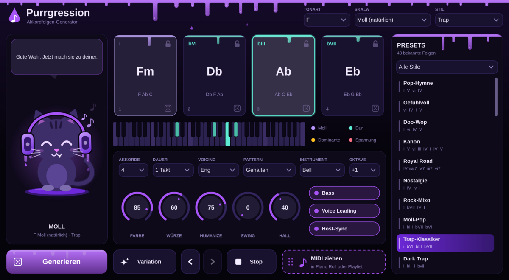

# Purrgression

Ein Akkordfolgen-Generator als VST3-Plugin für FL Studio (und jede andere DAW mit VST3),
mit Moll, der Nachtkatze mit tropfenden Kopfhörern, als Maskottchen auf dem Overlay im dunklen Lila-Drip-Design.



## Was das Plugin kann

- **48 Presets** mit bekannten und häufig benutzten Akkordfolgen, sortiert nach Pop, Trap, Hip-Hop,
  Lo-Fi, Jazz, R&B und Düster (z. B. Pop-Hymne I–V–vi–IV, Trap-Klassiker i–VI–III–VII, ii-V-I,
  Andalusisch, Kanon, Royal Road). Ein Klick setzt die Folge in deine Tonart.
- **Generieren** per Klick: Akkordfolgen mit 2 bis 8 Akkorden in 12 Tonarten und 8 Skalen
  (Moll natürlich/harmonisch/melodisch, Dorisch, Phrygisch, Dur, Mixolydisch, Lydisch).
- **5 Stile** mit eigenen Vorlagen und Gewohnheiten: Trap, Hip-Hop, Lo-Fi, Jazz, R&B / Neo-Soul.
- **Viele Variationen**
  - *Variation* verändert die aktuelle Folge nur leicht (Akkord tauschen, umfärben, Turnaround).
  - Würfel auf jeder Karte würfelt nur diesen einen Akkord neu, Schloss hält ihn fest.
  - *Farbe* regelt, wie reich die Akkorde sind (Dreiklang bis 9/11/13).
  - *Würze* regelt Substitutionen: Zwischendominanten, Tritonus-Substitution, geliehene Akkorde,
    Neapolitaner, Sus-Akkorde, verminderte Durchgänge.
  - 5 Voicings (Eng, Offen, Drop 2, Shell, Rootless) mit automatischer Stimmführung.
  - 8 Patterns (Gehalten, Strum, Stabs, Lo-Fi Bounce, Boom-Bap, drei Arpeggios), dazu Humanize und Swing.
  - Verlauf mit Zurück/Vor, damit keine gute Idee verloren geht.
- **Übersichtliches Overlay**: Karten mit Akkordname, Stufe (römische Ziffern) und Tönen,
  Farbcode für Moll/Dur/Dominante/Spannung, Klaviatur mit den gespielten Tönen.
- **MIDI in FL Studio**: Feld *MIDI ziehen* direkt in die Piano Roll oder Playlist ziehen.
- **10 eingebaute Instrumente**: E-Piano, Piano, Pad, Dark Pad, Strings, Pluck, Bell, Orgel, Gitarre, Flöte,
  mit regelbarem Hall. Dazu MIDI-Ausgang für andere Instrumente.
- **Tasten-Trigger**: die weißen Tasten ab C5 (MIDI 60) spielen Akkord 1 bis 8.
- **Host-Sync**: läuft im Takt mit, sobald FL Studio abspielt.
- Die Folge und alle Einstellungen werden im Projekt gespeichert.

## Bauen

Das hier ist der Quellcode. Daraus muss einmal die Datei `Purrgression.vst3` gebaut werden.

### Weg A: ohne Installation, über GitHub (am einfachsten)

1. Auf github.com ein neues (privates) Repository anlegen und den Inhalt dieses Ordners hochladen.
2. Im Repository auf den Reiter **Actions** gehen. Der Lauf „Plugin bauen“ startet automatisch
   (sonst: „Run workflow“).
3. Nach etwa 10 Minuten den fertigen Lauf öffnen und unten bei **Artifacts**
   `Purrgression-Windows-VST3` herunterladen und entpacken.

### Weg B: lokal unter Windows

Einmalig installieren:

- [Visual Studio 2022 Community](https://visualstudio.microsoft.com/de/) mit dem Workload
  „Desktopentwicklung mit C++“
- [CMake](https://cmake.org/download/) (bei der Installation „Add CMake to the system PATH“ anhaken)
- [Git](https://git-scm.com/)

Dann `build_windows.bat` doppelklicken. JUCE wird beim ersten Mal automatisch heruntergeladen.
Das Ergebnis liegt in `build\Purrgression_artefacts\Release\VST3\Purrgression.vst3`.

### Weg C: macOS

```
cmake -B build -G Xcode "-DCMAKE_OSX_ARCHITECTURES=arm64;x86_64"
cmake --build build --config Release
```

Das Plugin liegt danach in `build/Purrgression_artefacts/Release/VST3/` und gehört nach
`~/Library/Audio/Plug-Ins/VST3/`.

## In FL Studio installieren

1. Den ganzen Ordner `Purrgression.vst3` nach `C:\Program Files\Common Files\VST3` kopieren.
2. FL Studio: **Options → Manage plugins → Find installed plugins**.
3. Purrgression taucht unter den Generatoren (Instrumenten) auf. In den Channel Rack laden.

Mitgebaut wird auch eine Standalone-Version (`...\Release\Standalone\Purrgression.exe`)
zum Ausprobieren ohne DAW.

## Bedienung

| Bereich | Funktion |
|---|---|
| Tonart, Skala, Stil | Oben rechts. Tonart transponiert die Folge, Skala und Stil generieren neu. |
| Presets | Rechts in der Liste eine Folge anklicken. Oben in der Liste nach Stil filtern. Danach lässt sie sich mit Variation, Würfel und Schloss weiter verändern. |
| Karten | Klick: Akkord anhören. Schloss: festhalten. Würfel oder Rechtsklick: nur diesen Akkord neu. |
| Generieren | Neue Folge. Abgeschlossene Akkorde bleiben stehen. |
| Variation | Kleine Änderung an der aktuellen Folge. |
| Pfeile | Im Verlauf zurück und vor. |
| Play | Spielt die Folge als Loop im Tempo des Projekts. |
| MIDI ziehen | Feld festhalten und in die Piano Roll, Playlist oder auf einen Kanal ziehen. Doppelklick zeigt die Datei im Explorer. |
| Farbe, Würze | Wirken beim nächsten Generieren. |
| Voicing, Pattern, Dauer, Oktave, Bass, Humanize, Swing | Wirken sofort, die Akkorde bleiben gleich. |
| Instrument, Hall | Eingebauter Klang und sein Hall-Anteil. „Aus“ schaltet den eingebauten Klang stumm. |
| Host-Sync | Wenn an, spielt das Plugin mit, sobald FL Studio läuft. |

### Akkorde live an ein anderes Instrument schicken

Das Plugin gibt alles, was es spielt, auch als MIDI aus.

1. Im Fenster von Purrgression oben links auf das Zahnrad → **VST wrapper settings**,
   unter MIDI bei **Output port** z. B. `1` einstellen.
2. Beim Ziel-Instrument an derselben Stelle **Input port** auf `1` stellen.
3. *Instrument* in Purrgression auf „Aus“, damit nur das Ziel-Instrument klingt.

### Akkorde über Tasten spielen

Noten für Purrgression in die Piano Roll setzen oder auf dem Keyboard spielen:
C5, D5, E5, F5, G5, A5, B5, C6 (die weißen Tasten ab MIDI-Note 60) lösen Akkord 1 bis 8 aus,
solange die Taste gehalten wird.

## Projektaufbau

```
Source/ChordEngine.h       Harmonielehre, Generator, Variationen, Voicings, Patterns, MIDI-Datei (ohne JUCE)
Source/PreviewSynth.h      die eingebauten Instrumente (ohne JUCE)
Source/PluginProcessor.*   Sequenzer, MIDI ein/aus, Host-Sync, Speichern/Laden
Source/PluginEditor.*      Overlay
Source/Mascot.h            Moll, die Katze (komplett als Vektorgrafik gezeichnet)
Source/Widgets.h           Akkordkarten, Preset-Browser, Klaviatur, Buttons, Drag-Feld
Source/Theme.h             Farben, Schrift, Icons
tests/                     Tests für Engine und Plugin, rendert das Overlay als PNG
```

Eigene Presets lassen sich in `ChordEngine.h` in der Tabelle in `presetTable()` ergänzen
(Halbtöne über der Tonika plus Akkordtyp). Eigene Generator-Vorlagen lassen sich in `ChordEngine.h` in der Tabelle in `pickTemplate()`
ergänzen (Zahlen 1 bis 7 sind die Stufen der gewählten Skala).

## Stand der Tests

Der Code wurde unter Linux gegen JUCE 8.0.8 kompiliert, die Engine und der Prozessor
(Abspielen, Tasten-Trigger, MIDI-Datei, Speichern/Laden) wurden automatisch getestet und das
Overlay wurde gerendert (Bilder in `docs/`). Der Windows-Build läuft über GitHub Actions.
**Nicht** getestet ist das Verhalten in FL Studio selbst, insbesondere Drag & Drop in die Piano Roll,
und die Instrumente wurden nur gemessen (Stimmung, Pegel), nicht angehört.

## Lizenz-Hinweis

Das Plugin nutzt [JUCE](https://juce.com) (AGPLv3 oder kommerzielle Lizenz). Für den eigenen
Gebrauch ist das unproblematisch. Wer das Plugin weitergibt oder verkauft, muss die
JUCE-Lizenzbedingungen beachten.
